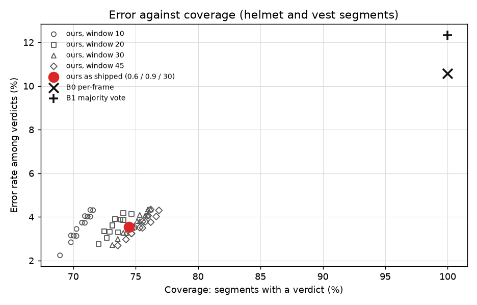

# VisionWorks safety evaluation

Generated by `backend/eval/write_report.py` from the results files; every number below is read from them. Re-run the three evaluation scripts and this one to bring it up to date (design §14, Step 17).

**How to read it.** A *false accusation* is flagging someone who was wearing the item: the error that matters most. *Abstaining* ("could not verify") is not an error: it is the system refusing to guess, and it is counted, not hidden. A count of zero is given with its 95 % upper bound by the rule of three (3 / N); other counts with the upper end of the 95 % Wilson interval. *Coverage* is the share of cases where the system gave a verdict.

## 1. Helmet and vest: our evidence layer against two simpler systems (§14.A, §14.G)

**Data.** Construction-PPE (Ultralytics, CC BY 4.0, partly generated imagery), whose labels say explicitly when a helmet or vest is missing. Main result: the 100 validation images never used in training or in choosing the model (valB), 454 person-and-item segments. Each segment is up to 45 frames: the image itself, then the same still scene through slightly different camera moments (shift, zoom, light, blur, JPEG), every frame read by the production detector (`runs\ppe_yolov8m_ft1\weights\best.pt`), association and clear-frame gate. **People do not move or turn here**, so this measures the decision against a real detector's frame-to-frame jitter on a camera, not against motion, turning or occlusion; own footage (§14.A as planned: 480 recorded segments) has not been recorded.

**Systems.** B0 decides from one frame (the clean image): no detection of 0.45 or more on the person means a violation. B1 takes a majority over 30 frames, with no clear-frame gate and no abstention. Ours is the product as shipped: presence 0.6, absence 0.9, window 30, at least 8 clear frames, otherwise UNVERIFIABLE.

### Both items (main result)

| System | Segments | False accusations (of those wearing it) | False compliance (of those without it) | Abstained | Coverage | Error among verdicts |
|---|---:|---:|---:|---:|---:|---:|
| B0 per-frame (one frame decides) | 454 | 37 of 321 (11.5%; at most 15.5%) | 11 of 133 (8.3%; at most 14.2%) | 0 | 100.0% | 10.6% |
| B1 majority vote over the window | 454 | 47 of 321 (14.6%; at most 18.9%) | 9 of 133 (6.8%; at most 12.4%) | 0 | 100.0% | 12.3% |
| **Ours** (clear frames, 60 % / 90 %, abstains) | 454 | 6 of 321 (1.9%; at most 4.0%) | 6 of 133 (4.5%; at most 9.5%) | 116 | 74.5% | 3.5% |

### Helmet

| System | Segments | False accusations (of those wearing it) | False compliance (of those without it) | Abstained | Coverage | Error among verdicts |
|---|---:|---:|---:|---:|---:|---:|
| B0 per-frame (one frame decides) | 225 | 24 of 165 (14.5%; at most 20.7%) | 7 of 60 (11.7%; at most 22.2%) | 0 | 100.0% | 13.8% |
| B1 majority vote over the window | 225 | 28 of 165 (17.0%; at most 23.4%) | 6 of 60 (10.0%; at most 20.2%) | 0 | 100.0% | 15.1% |
| **Ours** (clear frames, 60 % / 90 %, abstains) | 225 | 3 of 165 (1.8%; at most 5.2%) | 4 of 60 (6.7%; at most 15.9%) | 59 | 73.8% | 4.2% |

### Vest

| System | Segments | False accusations (of those wearing it) | False compliance (of those without it) | Abstained | Coverage | Error among verdicts |
|---|---:|---:|---:|---:|---:|---:|
| B0 per-frame (one frame decides) | 229 | 13 of 156 (8.3%; at most 13.7%) | 4 of 73 (5.5%; at most 13.3%) | 0 | 100.0% | 7.4% |
| B1 majority vote over the window | 229 | 19 of 156 (12.2%; at most 18.2%) | 3 of 73 (4.1%; at most 11.4%) | 0 | 100.0% | 9.6% |
| **Ours** (clear frames, 60 % / 90 %, abstains) | 229 | 3 of 156 (1.9%; at most 5.5%) | 2 of 73 (2.7%; at most 9.4%) | 57 | 75.1% | 2.9% |

### What it shows

- Ours wrongly flags **6 of 321** people who were wearing the item (1.9%), against 37 (11.5%) for the per-frame system and 47 (14.6%) for the majority vote: about 6 times fewer than per-frame.
- The price is abstention: ours gives a verdict on 74.5% of segments and says it could not verify the rest (116). Among the verdicts it gives, 3.5% are wrong, against 10.6% and 12.3%.
- The majority vote is WORSE than one frame here: with no clear-frame gate it accuses small, distant people whose items the detector cannot see in any frame. That is the case the clear-frame gate exists for.
- **The target of zero false accusations is not met.** Every one of our false accusations is a case where the detector found the item in none of the frames: a helmet behind an excavator's cab glass, a small red helmet on a partly hidden worker, a grey (non hi-vis) vest the model does not recognise, a close-up with the helmet covered by a device, and two workers in grey uniforms that the dataset labels as wearing a vest although no vest is visible (arguably label errors). A temporal rule cannot fix an error that is the same in every frame; these become POTENTIAL_VIOLATION flags, which a person reviews before anything happens.

### By person height (both items): false accusations

| Person height | Segments | B0 per-frame | B1 majority vote | Ours | Ours abstained |
|---|---:|---:|---:|---:|---:|
| under 90 px | 96 | 28 of 57 (49.1%; at most 61.7%) | 33 of 57 (57.9%; at most 69.8%) | 1 of 57 (1.8%; at most 9.3%) | 93 |
| 90-200 px | 109 | 4 of 92 (4.3%; at most 10.7%) | 9 of 92 (9.8%; at most 17.6%) | 2 of 92 (2.2%; at most 7.6%) | 15 |
| 200 px and over | 249 | 5 of 172 (2.9%; at most 6.6%) | 5 of 172 (2.9%; at most 6.6%) | 3 of 172 (1.7%; at most 5.0%) | 8 |

Below 90 px tall nobody can be judged reliably: the per-frame and majority systems accuse about half of those wearing the item; ours abstains on almost all of them.

### Threshold sweep: why 0.60 and 0.90

64 settings (presence 0.4 to 0.7, absence 0.7 to 0.95, window 10 to 45 frames) all lie between about 2.2% and 4.3% error at 68.9% to 76.9% coverage; the two baselines sit at 100 % coverage and over 10 % error. The shipped setting (0.6 / 0.9 / 30) is in the middle of that band: stricter settings (presence 0.7, absence 0.95) cut the error a little further at a few points less coverage. The choice is a trade-off on this curve, not a tuned optimum; the full table is in `ppe_training/reports/SEGMENT_EVAL.md`.

**A larger, slightly less clean set.** On all 200 validation images (924 segments; half of them were used to pick the training epoch): ours 9 false accusations of 623, per-frame 53, majority 70.

### Train / test overlap

Every valB image was compared with every image the model was trained on (perceptual hash, also mirrored; `ppe_training/check_leakage.py`): 0 identical, 1 near-duplicate of 100; the one close pair is the same gate camera with a different person, so the result above is not inflated by copied pictures. The public PPE-6 test split behind the earlier per-class detector numbers is not clean: 43 of its 213 images are identical to a training image and 89 are near-duplicates (frames of the same videos). Measured again without them, helmet precision at confidence 0.35 falls from about 0.83 to about 0.68 (fewer than 35 helmets left, so a rough figure); the full table is in `ppe_training/reports/LEAKAGE_CHECK.md`.

## 2. Scenarios through the real engine (§14.B)

Each scenario ran 18 times, at 10, 15 and 25 frames a second, with its timing and positions varied, through `SafetySession`: the zone tracker, the rule engine, the PPE evidence layer, man-down, the head count and the writer into a real SQLite file; every outcome is read back from that file. What the models see is scripted (boxes, zones, items, poses), so this measures the logic, not the models' eyes. S1n to S3n replace the perfect detector with the PPE model's measured per-frame error rates on clear frames (independent from frame to frame; correlated errors are what section 1 measures).

**270 correct, 0 abstained, 0 wrong of 270 runs.**

| Scenario | Expected | Runs | Correct | Abstained | Wrong | Timing, worst run |
|---|---|---:|---:|---:|---:|---|
| S1 Equipped worker enters the restricted zone | COMPLIANT | 18 | 18 | 0 | 0 | entry ±0.08 s, exit ±0.07 s, stay ±0.05 s |
| S2 Worker without a helmet enters | POTENTIAL_VIOLATION | 18 | 18 | 0 | 0 | entry ±0.10 s, exit ±0.10 s, stay ±0.06 s |
| S3 Worker without a vest enters | POTENTIAL_VIOLATION | 18 | 18 | 0 | 0 | entry ±0.10 s, exit ±0.08 s, stay ±0.07 s |
| S1n S1 with the model's measured per-frame errors | COMPLIANT (or UNVERIFIABLE; never the opposite claim) | 18 | 18 | 0 | 0 | entry ±0.07 s, exit ±0.09 s, stay ±0.07 s |
| S2n S2 with the model's measured per-frame errors | POTENTIAL_VIOLATION (or UNVERIFIABLE; never the opposite claim) | 18 | 18 | 0 | 0 | entry ±0.10 s, exit ±0.07 s, stay ±0.07 s |
| S3n S3 with the model's measured per-frame errors | POTENTIAL_VIOLATION (or UNVERIFIABLE; never the opposite claim) | 18 | 18 | 0 | 0 | entry ±0.10 s, exit ±0.09 s, stay ±0.07 s |
| S4 Worker far away or partly hidden enters (no helmet visible) | UNVERIFIABLE | 18 | 18 | 0 | 0 |  |
| S5 Two workers close together, only one equipped | each judged on their own; overlapping -> UNVERIFIABLE | 18 | 18 | 0 | 0 |  |
| S6 Worker stands on a zone boundary (the foot point flickers across it) | one entry, not many | 18 | 18 | 0 | 0 |  |
| S7 Worker stays beyond the time limit (and, as a control, within it) | warning, then POTENTIAL_VIOLATION; within: COMPLIANT | 18 | 18 | 0 | 0 | entry ±0.07 s, exit ±0.06 s, stay ±0.05 s |
| S8 Worker leaves by the wrong route (and, as controls, is lost from view, or uses the exit) | wrong route: POTENTIAL_VIOLATION; lost: UNVERIFIABLE; exit: COMPLIANT | 18 | 18 | 0 | 0 |  |
| S9 Worker alone in a two-person zone (and, as a control, two workers) | LONE_WORKER after the grace; two: nothing | 18 | 18 | 0 | 0 |  |
| S10 Worker hidden for a few seconds inside the zone, then seen again | the same visit continues | 18 | 18 | 0 | 0 | entry ±0.09 s, exit ±0.09 s, stay ±0.03 s |
| M1 A worker falls and lies still (classifier labels them SITTING) | POTENTIAL_VIOLATION (CRITICAL) within seconds | 18 | 18 | 0 | 0 | alert 5.6 s after the fall (median; 5.75 s worst) |
| M2 Hard negatives: bending over, sitting upright, crawling | nothing | 18 | 18 | 0 | 0 |  |

Variants inside each scenario (from the per-run results): S4 far away and head cut off; S5 overlapping (both UNVERIFIABLE) and side by side (judged separately); S7 over and within the limit; S8 wrong route, lost from view and the right exit; S9 alone and two people; S10 2, 3.5 and 6 s out of view (6 s is past the 5 s "lost" point, and the visit still continues); M2 bending over, sitting upright and crawling. The per-run outcomes and the confusion counts are in `backend/eval/results/safety_evaluation.json`.

## 3. The whole chain on real video (§14.C, §14.D, §14.E)

Hardware: **NVIDIA GeForce RTX 4060 Laptop GPU**, Intel64 Family 6 Model 183 Stepping 1, GenuineIntel, 20 CPU threads, 23.7 GB RAM, Windows 10, torch 2.5.1+cu121. Pose model on the original frame up to 1280 px wide; PPE model every 2 frames up to 1280 px, with close-up crops below 360 px; the safety layer with man-down, head-count and helmet-and-vest rules on a whole-picture zone; up to the first two minutes of each clip.

| Clip | Seconds | Input | Processed fps | ms per frame (95th pct) | Pose / PPE / safety ms | Man-down flags |
|---|---:|---:|---:|---:|---:|---:|
| Example of Hi-Definition Video Surveillance of a Factory Floor - by CCTVDOC.COM.mp4 | 17.0 | 1280x720 | 13.7 | 73.0 (137.8) | 33.5 / 75.8 / 1.0 | 0 |
| _ Hikvision ViewStar 8 Megapixel warehouse pallet company camera.mp4 | 37.0 | 1280x720 | 18.55 | 53.9 (100.6) | 32.8 / 40.1 / 0.5 | 0 |
| vtest.avi | 79.5 | 768x576 | 27.19 | 36.8 (74.3) | 17.6 / 34.9 / 0.8 | 0 |
| PPE-test.mp4 | 6.0 | 640x360 | 34.32 | 29.1 (44.4) | 11.8 / 32.6 / 0.7 | 0 |

- **Speed (§14.E).** Target 10 processed frames a second with pose and PPE: met on every clip.
- **Alert latency.** A decision is made inside the frame that triggers it, so the event-to-decision time is one frame's processing time (the table's ms per frame). The live view shows it in that frame's message. The Review queue sees it after the background sync to Postgres and the dashboard's 15 s poll, so add up to about a minute; that part depends on the network and was not measured here.
- **Man-down false alarms (§14.C).** None of these clips shows anyone falling, so every man-down flag is a false alarm: **0 in 2.3 minutes** (0.0 an hour; target at most 1). That is too little normal footage to state an hourly rate with confidence (the plan asks for an hour with hard negatives).
- **Man-down recall and time to alert** on real falls: not measured, no fall has been recorded. On scripted falls (scenario M1) the alert comes 5.6 s after the fall (median), within the 8 s target.
- **Head count (§14.D).** The counts per second are in `backend/eval/results/real_footage.json`. Checked by eye against sampled frames during Step 15: they match where people are large enough, and undercount tiny, distant people, which the 60 px floor turns into "could not verify" rather than a false lone-worker flag.

### What the rules raised on these clips, against what the clips show (by eye; there are no labels)

- **Example of Hi-Definition Video Surveillance of a Factory Floor - by CCTVDOC.COM.mp4**: helmet and vest 1 compliant, 3 flagged, 5 could not verify; head count 1 decision(s) (POTENTIAL_VIOLATION OVER_CAPACITY at 0.8 s). By eye: workers in orange hi-vis vests and no helmets, 5 to 7 people around a table. The flags fit (no helmet); the one COMPLIANT is probably a false compliance (no helmet is visible on anyone in the sampled frames); the many UNVERIFIABLE are small or overlapping people. Over capacity (more than 2) is correct.
- **_ Hikvision ViewStar 8 Megapixel warehouse pallet company camera.mp4**: helmet and vest 2 flagged, 3 could not verify; head count 0 decision(s). By eye: two or three workers in caps and dark shirts, no helmets or vests. The flags fit; nothing was called compliant.
- **vtest.avi**: helmet and vest 10 flagged, 28 could not verify; head count 1 decision(s) (POTENTIAL_VIOLATION OVER_CAPACITY at 44.2 s). By eye: pedestrians on a campus path, nobody wearing a helmet or vest. Every flag is true; most people are small and were left UNVERIFIABLE. Over capacity (more than 2) is correct.
- **PPE-test.mp4**: helmet and vest 1 compliant, 1 flagged; head count 0 decision(s). By eye: two workers: one with a white helmet and a hi-vis vest, one with a yellow helmet and no vest. Exactly right: one COMPLIANT, one flagged.

## 4. The human review loop (§14.F)

Not measured on a reviewed set of clips: it needs people to confirm or dismiss every flag of a recorded run. The Evaluation screen shows the organisation's own figures as reviews happen (flags judged, the share people agreed with, the reasons given, and how many could-not-verify decisions were later found real), from the same database function as the Reports page.

## 5. What is not measured, and why

- **Own footage (§14.A as planned).** No segments of workers recorded on site with known equipment. Section 1 uses still labelled images with camera jitter instead; it cannot show the effect of people walking, turning or being hidden.
- **Staged falls (§14.C).** No recorded falls, so man-down recall is not stated. Scripted falls and normal real footage only show the logic and the absence of false alarms over a few minutes.
- **Human-judged precision (§14.F).** Needs a reviewed run; the screen will show it as reviews come in.
- **Identity on (§14.E second target).** The identity layer is not part of this product, so only the identity-off speed is reported.

