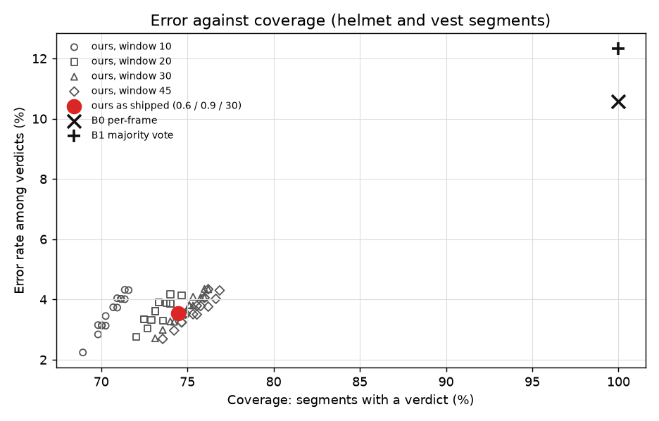

# PPE segment evaluation: our evidence layer against two baselines

Generated by `ppe_training/eval_segments.py`. Each person and item is one segment of up to 45 frames: the labelled, held-out image as it is (frame 0) and then the same scene through slightly different camera moments (shift, zoom, light, blur, JPEG). People do not move or turn here, so this measures the system against detector jitter on a camera, not against motion or occlusion. Every frame goes through the production detector, association and clear-frame gate.

Defaults: presence 0.6, absence 0.9, window 30 frames, at least 8 clear frames; the baselines count an item as seen at a detection of 0.45 or more.

## valB: never used in training or in choosing the model (main result)

100 images, 454 segments.

### Both items

| system | N | caught | cleared | **false accusations** | false compliance | abstained | coverage | error rate |
|---|---:|---:|---:|---:|---:|---:|---:|---:|
| B0 per-frame | 454 | 122 | 284 | 37 of 321 worn (11.5%; 95% upper 15.5%) | 11 of 133 missing (8.3%; 95% upper 14.2%) | 0 | 100.0% | 10.6% |
| B1 majority vote | 454 | 124 | 274 | 47 of 321 worn (14.6%; 95% upper 18.9%) | 9 of 133 missing (6.8%; 95% upper 12.4%) | 0 | 100.0% | 12.3% |
| ours | 454 | 83 | 243 | 6 of 321 worn (1.9%; 95% upper 4.0%) | 6 of 133 missing (4.5%; 95% upper 9.5%) | 116 | 74.5% | 3.5% |

### Helmet

| system | N | caught | cleared | **false accusations** | false compliance | abstained | coverage | error rate |
|---|---:|---:|---:|---:|---:|---:|---:|---:|
| B0 per-frame | 225 | 53 | 141 | 24 of 165 worn (14.5%; 95% upper 20.7%) | 7 of 60 missing (11.7%; 95% upper 22.2%) | 0 | 100.0% | 13.8% |
| B1 majority vote | 225 | 54 | 137 | 28 of 165 worn (17.0%; 95% upper 23.4%) | 6 of 60 missing (10.0%; 95% upper 20.2%) | 0 | 100.0% | 15.1% |
| ours | 225 | 32 | 127 | 3 of 165 worn (1.8%; 95% upper 5.2%) | 4 of 60 missing (6.7%; 95% upper 15.9%) | 59 | 73.8% | 4.2% |

### Vest

| system | N | caught | cleared | **false accusations** | false compliance | abstained | coverage | error rate |
|---|---:|---:|---:|---:|---:|---:|---:|---:|
| B0 per-frame | 229 | 69 | 143 | 13 of 156 worn (8.3%; 95% upper 13.7%) | 4 of 73 missing (5.5%; 95% upper 13.3%) | 0 | 100.0% | 7.4% |
| B1 majority vote | 229 | 70 | 137 | 19 of 156 worn (12.2%; 95% upper 18.2%) | 3 of 73 missing (4.1%; 95% upper 11.4%) | 0 | 100.0% | 9.6% |
| ours | 229 | 51 | 116 | 3 of 156 worn (1.9%; 95% upper 5.5%) | 2 of 73 missing (2.7%; 95% upper 9.4%) | 57 | 75.1% | 2.9% |

### By person height (both items)

**under 90 px**

| system | N | caught | cleared | **false accusations** | false compliance | abstained | coverage | error rate |
|---|---:|---:|---:|---:|---:|---:|---:|---:|
| B0 per-frame | 96 | 35 | 29 | 28 of 57 worn (49.1%; 95% upper 61.7%) | 4 of 39 missing (10.3%; 95% upper 23.6%) | 0 | 100.0% | 33.3% |
| B1 majority vote | 96 | 37 | 24 | 33 of 57 worn (57.9%; 95% upper 69.8%) | 2 of 39 missing (5.1%; 95% upper 16.9%) | 0 | 100.0% | 36.5% |
| ours | 96 | 1 | 1 | 1 of 57 worn (1.8%; 95% upper 9.3%) | 0 of 39 missing (0.0%; 95% upper 7.7%) | 93 | 3.1% | 33.3% |

**90-200 px**

| system | N | caught | cleared | **false accusations** | false compliance | abstained | coverage | error rate |
|---|---:|---:|---:|---:|---:|---:|---:|---:|
| B0 per-frame | 109 | 11 | 88 | 4 of 92 worn (4.3%; 95% upper 10.7%) | 6 of 17 missing (35.3%; 95% upper 58.7%) | 0 | 100.0% | 9.2% |
| B1 majority vote | 109 | 11 | 83 | 9 of 92 worn (9.8%; 95% upper 17.6%) | 6 of 17 missing (35.3%; 95% upper 58.7%) | 0 | 100.0% | 13.8% |
| ours | 109 | 8 | 79 | 2 of 92 worn (2.2%; 95% upper 7.6%) | 5 of 17 missing (29.4%; 95% upper 53.1%) | 15 | 86.2% | 7.4% |

**200 px and over**

| system | N | caught | cleared | **false accusations** | false compliance | abstained | coverage | error rate |
|---|---:|---:|---:|---:|---:|---:|---:|---:|
| B0 per-frame | 249 | 76 | 167 | 5 of 172 worn (2.9%; 95% upper 6.6%) | 1 of 77 missing (1.3%; 95% upper 7.0%) | 0 | 100.0% | 2.4% |
| B1 majority vote | 249 | 76 | 167 | 5 of 172 worn (2.9%; 95% upper 6.6%) | 1 of 77 missing (1.3%; 95% upper 7.0%) | 0 | 100.0% | 2.4% |
| ours | 249 | 74 | 163 | 3 of 172 worn (1.7%; 95% upper 5.0%) | 1 of 77 missing (1.3%; 95% upper 7.0%) | 8 | 96.8% | 1.7% |

### Threshold sweep (both items)

| presence | absence | window | coverage | error rate | false accusations | false compliance | abstained |
|---:|---:|---:|---:|---:|---:|---:|---:|
| 0.4 | 0.7 | 10 | 71.6% | 4.3% | 7 | 7 | 129 |
| 0.4 | 0.7 | 20 | 74.7% | 4.1% | 7 | 7 | 115 |
| 0.4 | 0.7 | 30 | 76.2% | 4.3% | 8 | 7 | 108 |
| 0.4 | 0.7 | 45 | 76.9% | 4.3% | 8 | 7 | 105 |
| 0.4 | 0.8 | 10 | 71.4% | 4.3% | 7 | 7 | 130 |
| 0.4 | 0.8 | 20 | 74.0% | 3.9% | 6 | 7 | 118 |
| 0.4 | 0.8 | 30 | 76.0% | 4.1% | 7 | 7 | 109 |
| 0.4 | 0.8 | 45 | 76.6% | 4.0% | 7 | 7 | 106 |
| 0.4 | 0.9 | 10 | 71.2% | 4.0% | 6 | 7 | 131 |
| 0.4 | 0.9 | 20 | 74.0% | 3.9% | 6 | 7 | 118 |
| 0.4 | 0.9 | 30 | 75.3% | 3.8% | 6 | 7 | 112 |
| 0.4 | 0.9 | 45 | 76.2% | 3.8% | 6 | 7 | 108 |
| 0.4 | 0.95 | 10 | 70.3% | 3.5% | 4 | 7 | 135 |
| 0.4 | 0.95 | 20 | 73.6% | 3.3% | 4 | 7 | 120 |
| 0.4 | 0.95 | 30 | 74.9% | 3.5% | 5 | 7 | 114 |
| 0.4 | 0.95 | 45 | 75.5% | 3.5% | 5 | 7 | 111 |
| 0.5 | 0.7 | 10 | 71.4% | 4.0% | 7 | 6 | 130 |
| 0.5 | 0.7 | 20 | 74.0% | 4.2% | 7 | 7 | 118 |
| 0.5 | 0.7 | 30 | 76.0% | 4.3% | 8 | 7 | 109 |
| 0.5 | 0.7 | 45 | 76.2% | 4.3% | 8 | 7 | 108 |
| 0.5 | 0.8 | 10 | 71.2% | 4.0% | 7 | 6 | 131 |
| 0.5 | 0.8 | 20 | 73.4% | 3.9% | 6 | 7 | 121 |
| 0.5 | 0.8 | 30 | 75.8% | 4.1% | 7 | 7 | 110 |
| 0.5 | 0.8 | 45 | 76.0% | 4.1% | 7 | 7 | 109 |
| 0.5 | 0.9 | 10 | 70.9% | 3.7% | 6 | 6 | 132 |
| 0.5 | 0.9 | 20 | 73.4% | 3.9% | 6 | 7 | 121 |
| 0.5 | 0.9 | 30 | 75.1% | 3.8% | 6 | 7 | 113 |
| 0.5 | 0.9 | 45 | 75.5% | 3.8% | 6 | 7 | 111 |
| 0.5 | 0.95 | 10 | 70.0% | 3.1% | 4 | 6 | 136 |
| 0.5 | 0.95 | 20 | 72.9% | 3.3% | 4 | 7 | 123 |
| 0.5 | 0.95 | 30 | 74.7% | 3.5% | 5 | 7 | 115 |
| 0.5 | 0.95 | 45 | 74.9% | 3.5% | 5 | 7 | 114 |
| 0.6 | 0.7 | 10 | 71.2% | 4.0% | 7 | 6 | 131 |
| 0.6 | 0.7 | 20 | 73.8% | 3.9% | 7 | 6 | 119 |
| 0.6 | 0.7 | 30 | 75.3% | 4.1% | 8 | 6 | 112 |
| 0.6 | 0.7 | 45 | 76.0% | 4.1% | 8 | 6 | 109 |
| 0.6 | 0.8 | 10 | 70.9% | 4.0% | 7 | 6 | 132 |
| 0.6 | 0.8 | 20 | 73.1% | 3.6% | 6 | 6 | 122 |
| 0.6 | 0.8 | 30 | 75.1% | 3.8% | 7 | 6 | 113 |
| 0.6 | 0.8 | 45 | 75.8% | 3.8% | 7 | 6 | 110 |
| 0.6 | 0.9 | 10 | 70.7% | 3.7% | 6 | 6 | 133 |
| 0.6 | 0.9 | 20 | 73.1% | 3.6% | 6 | 6 | 122 |
| 0.6 | 0.9 | 30 | 74.5% | 3.5% | 6 | 6 | 116 |
| 0.6 | 0.9 | 45 | 75.3% | 3.5% | 6 | 6 | 112 |
| 0.6 | 0.95 | 10 | 69.8% | 3.1% | 4 | 6 | 137 |
| 0.6 | 0.95 | 20 | 72.7% | 3.0% | 4 | 6 | 124 |
| 0.6 | 0.95 | 30 | 74.0% | 3.3% | 5 | 6 | 118 |
| 0.6 | 0.95 | 45 | 74.7% | 3.2% | 5 | 6 | 115 |
| 0.7 | 0.7 | 10 | 70.3% | 3.1% | 7 | 3 | 135 |
| 0.7 | 0.7 | 20 | 73.1% | 3.6% | 7 | 5 | 122 |
| 0.7 | 0.7 | 30 | 74.5% | 3.5% | 8 | 4 | 116 |
| 0.7 | 0.7 | 45 | 74.9% | 3.5% | 8 | 4 | 114 |
| 0.7 | 0.8 | 10 | 70.0% | 3.1% | 7 | 3 | 136 |
| 0.7 | 0.8 | 20 | 72.5% | 3.3% | 6 | 5 | 125 |
| 0.7 | 0.8 | 30 | 74.2% | 3.3% | 7 | 4 | 117 |
| 0.7 | 0.8 | 45 | 74.7% | 3.2% | 7 | 4 | 115 |
| 0.7 | 0.9 | 10 | 69.8% | 2.8% | 6 | 3 | 137 |
| 0.7 | 0.9 | 20 | 72.5% | 3.3% | 6 | 5 | 125 |
| 0.7 | 0.9 | 30 | 73.6% | 3.0% | 6 | 4 | 120 |
| 0.7 | 0.9 | 45 | 74.2% | 3.0% | 6 | 4 | 117 |
| 0.7 | 0.95 | 10 | 68.9% | 2.2% | 4 | 3 | 141 |
| 0.7 | 0.95 | 20 | 72.0% | 2.8% | 4 | 5 | 127 |
| 0.7 | 0.95 | 30 | 73.1% | 2.7% | 5 | 4 | 122 |
| 0.7 | 0.95 | 45 | 73.6% | 2.7% | 5 | 4 | 120 |

## All 200 validation images (valA was used to choose the training epoch, so this is slightly less clean)

200 images, 924 segments.

### Both items

| system | N | caught | cleared | **false accusations** | false compliance | abstained | coverage | error rate |
|---|---:|---:|---:|---:|---:|---:|---:|---:|
| B0 per-frame | 924 | 286 | 570 | 53 of 623 worn (8.5%; 95% upper 11.0%) | 15 of 301 missing (5.0%; 95% upper 8.1%) | 0 | 100.0% | 7.4% |
| B1 majority vote | 924 | 290 | 553 | 70 of 623 worn (11.2%; 95% upper 14.0%) | 11 of 301 missing (3.6%; 95% upper 6.4%) | 0 | 100.0% | 8.8% |
| ours | 924 | 197 | 490 | 9 of 623 worn (1.4%; 95% upper 2.7%) | 7 of 301 missing (2.3%; 95% upper 4.7%) | 221 | 76.1% | 2.3% |

### Helmet

| system | N | caught | cleared | **false accusations** | false compliance | abstained | coverage | error rate |
|---|---:|---:|---:|---:|---:|---:|---:|---:|
| B0 per-frame | 461 | 166 | 253 | 33 of 286 worn (11.5%; 95% upper 15.8%) | 9 of 175 missing (5.1%; 95% upper 9.5%) | 0 | 100.0% | 9.1% |
| B1 majority vote | 461 | 168 | 243 | 43 of 286 worn (15.0%; 95% upper 19.6%) | 7 of 175 missing (4.0%; 95% upper 8.0%) | 0 | 100.0% | 10.8% |
| ours | 461 | 111 | 225 | 6 of 286 worn (2.1%; 95% upper 4.5%) | 5 of 175 missing (2.9%; 95% upper 6.5%) | 114 | 75.3% | 3.2% |

### Vest

| system | N | caught | cleared | **false accusations** | false compliance | abstained | coverage | error rate |
|---|---:|---:|---:|---:|---:|---:|---:|---:|
| B0 per-frame | 463 | 120 | 317 | 20 of 337 worn (5.9%; 95% upper 9.0%) | 6 of 126 missing (4.8%; 95% upper 10.0%) | 0 | 100.0% | 5.6% |
| B1 majority vote | 463 | 122 | 310 | 27 of 337 worn (8.0%; 95% upper 11.4%) | 4 of 126 missing (3.2%; 95% upper 7.9%) | 0 | 100.0% | 6.7% |
| ours | 463 | 86 | 265 | 3 of 337 worn (0.9%; 95% upper 2.6%) | 2 of 126 missing (1.6%; 95% upper 5.6%) | 107 | 76.9% | 1.4% |

### By person height (both items)

**under 90 px**

| system | N | caught | cleared | **false accusations** | false compliance | abstained | coverage | error rate |
|---|---:|---:|---:|---:|---:|---:|---:|---:|
| B0 per-frame | 183 | 75 | 65 | 37 of 102 worn (36.3%; 95% upper 46.0%) | 6 of 81 missing (7.4%; 95% upper 15.2%) | 0 | 100.0% | 23.5% |
| B1 majority vote | 183 | 78 | 56 | 46 of 102 worn (45.1%; 95% upper 54.8%) | 3 of 81 missing (3.7%; 95% upper 10.3%) | 0 | 100.0% | 26.8% |
| ours | 183 | 1 | 2 | 1 of 102 worn (1.0%; 95% upper 5.3%) | 0 of 81 missing (0.0%; 95% upper 3.7%) | 179 | 2.2% | 25.0% |

**90-200 px**

| system | N | caught | cleared | **false accusations** | false compliance | abstained | coverage | error rate |
|---|---:|---:|---:|---:|---:|---:|---:|---:|
| B0 per-frame | 220 | 45 | 160 | 7 of 167 worn (4.2%; 95% upper 8.4%) | 8 of 53 missing (15.1%; 95% upper 27.1%) | 0 | 100.0% | 6.8% |
| B1 majority vote | 220 | 46 | 151 | 16 of 167 worn (9.6%; 95% upper 15.0%) | 7 of 53 missing (13.2%; 95% upper 24.8%) | 0 | 100.0% | 10.4% |
| ours | 220 | 42 | 146 | 5 of 167 worn (3.0%; 95% upper 6.8%) | 6 of 53 missing (11.3%; 95% upper 22.6%) | 21 | 90.5% | 5.5% |

**200 px and over**

| system | N | caught | cleared | **false accusations** | false compliance | abstained | coverage | error rate |
|---|---:|---:|---:|---:|---:|---:|---:|---:|
| B0 per-frame | 521 | 166 | 345 | 9 of 354 worn (2.5%; 95% upper 4.8%) | 1 of 167 missing (0.6%; 95% upper 3.3%) | 0 | 100.0% | 1.9% |
| B1 majority vote | 521 | 166 | 346 | 8 of 354 worn (2.3%; 95% upper 4.4%) | 1 of 167 missing (0.6%; 95% upper 3.3%) | 0 | 100.0% | 1.7% |
| ours | 521 | 154 | 342 | 3 of 354 worn (0.9%; 95% upper 2.5%) | 1 of 167 missing (0.6%; 95% upper 3.3%) | 21 | 96.0% | 0.8% |

